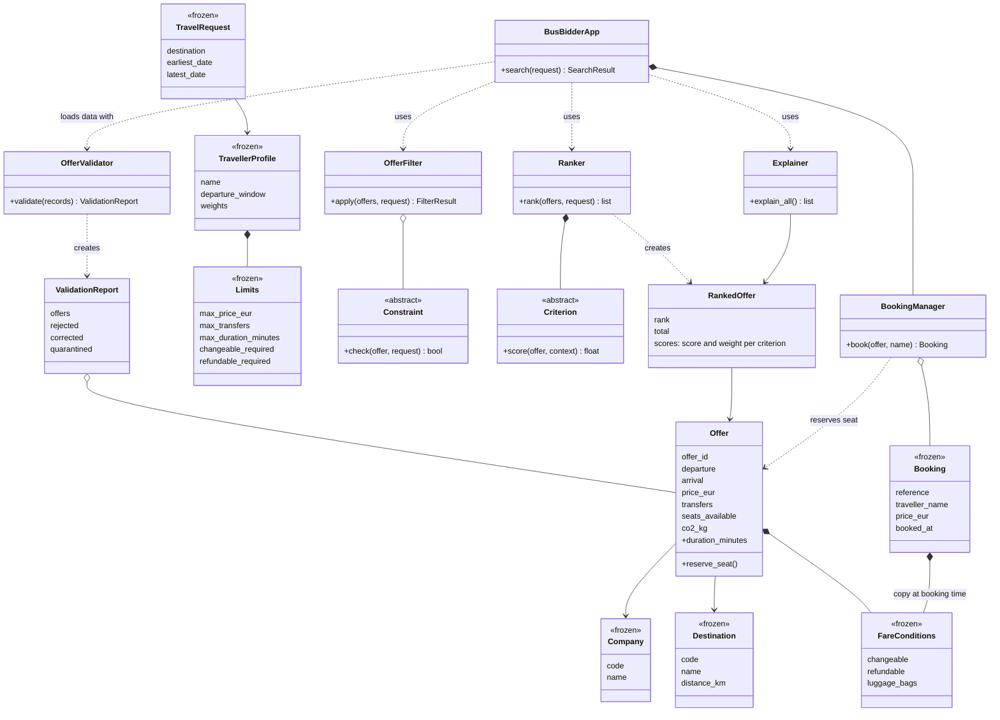
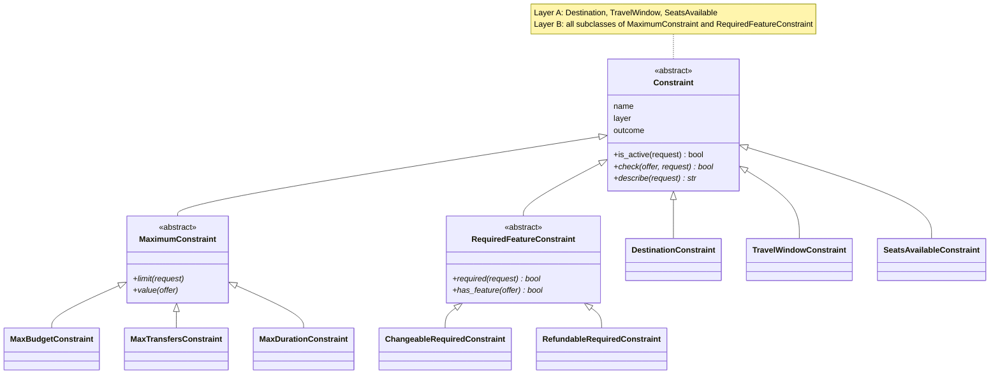
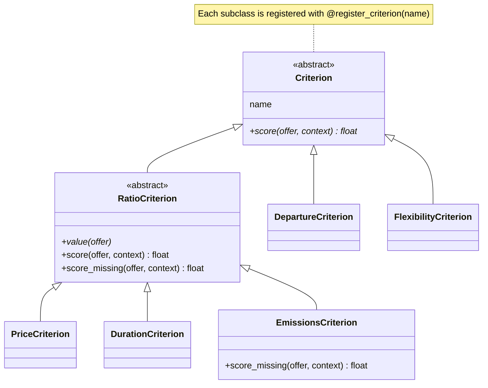

# Class diagrams

**Legend**
- Solid line with hollow triangle: inheritance (points to the parent class)
- Filled diamond: composition (the owner creates and holds the part)
- Hollow diamond: aggregation (the owner holds parts that exist on their own)
- Solid arrow: association (holds a reference to)
- Dashed arrow: dependency (uses or creates)
- «abstract»: abstract base class; methods in *italics* are abstract and must be implemented by subclasses
- «frozen»: frozen dataclass (cannot be changed after creation)

## 1. Main classes and how they work together

## 2. Constraint hierarchy (hard constraints)

## 3. Criterion hierarchy (scoring criteria)

